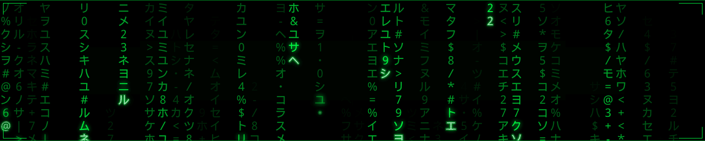
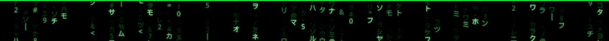

  

<h1 align="center">Command Lab</h1>

  Personal repository focused on Automation, Reusable Scripts, and Command Line Tools (CLI), primarily using Python.

  

<h2 align="center">Here you'll find:</h2>

- Controlled experiments with Python scripts.
- Automation Software development.
- Reusable utilities.
- CLI (Command Line Interface) Script development.

<table>
  <tr>
    <td width="5"></td>
    <td>No fluff... Just functional code, straight to the point.</td>
  </tr>
</table>

  

<h2 align="center">GitHub Stats</h2>

  

  

<h2 align="center">Coding Languages Used</h2>

  
  
  
  
  
  

  

<h2 align="center">Contact</h2>

   E-mail: <a href="mailto:SanctusLocalhost@Proton.me">SanctusLocalhost@Proton.me</a> 
   Telegram: <a href="https://t.me/Sanctus_Localhost">@Sanctus_Localhost</a>

  

<h2 align="center">Visitors</h2>

  

  

